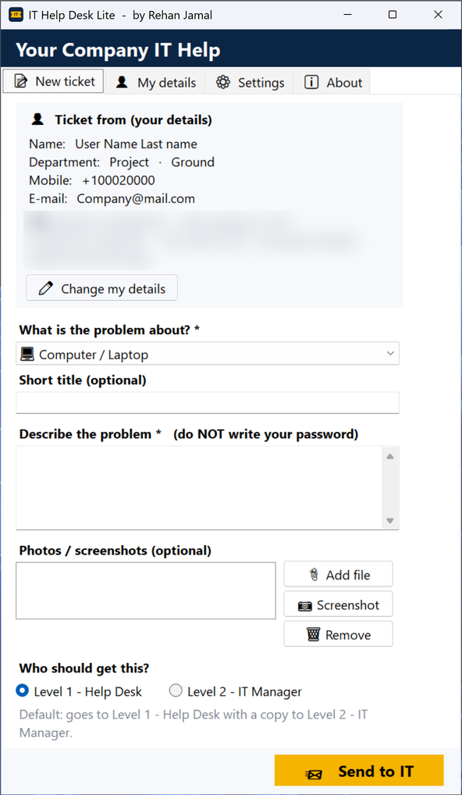
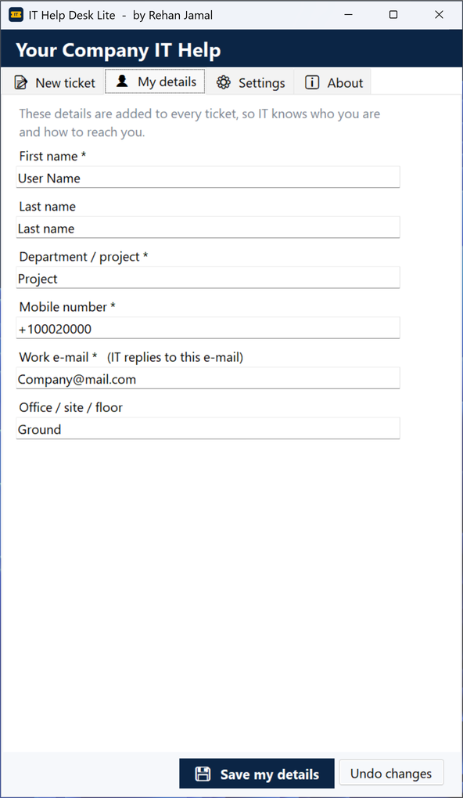
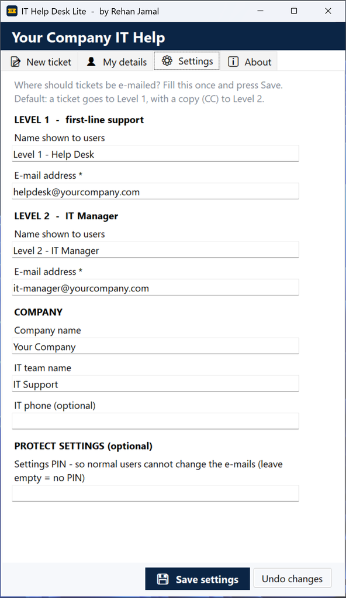
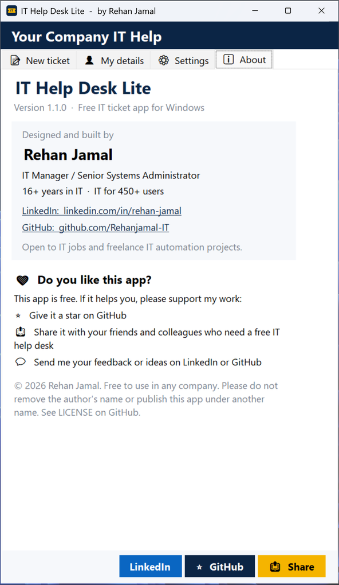

<p align="center"></p>

<h1 align="center">IT Help Desk Lite</h1>

<p align="center">
  <b>A free IT ticket app for Windows.</b><br>
  Employees report IT problems in under a minute, with screenshots and full computer details. There is no server, no licence cost and nothing to set up.
</p>

<p align="center">
  <a href="https://github.com/Rehanjamal-IT/it-helpdesk-lite/releases/latest"></a>
  
  
</p>

<p align="center">Built and used in a real company with <b>450+ employees</b>.</p>

<p align="center">
  
</p>

---

## 📑 Contents
- [Why this app?](#-why-this-app)
- [Features](#-features)
- [Screenshots](#-screenshots)
- [Download & install](#-download--install)
- [Setup for IT (one time, 2 minutes)](#-setup-for-it-one-time-2-minutes)
- [How employees use it](#-how-employees-use-it)
- [Deploy to many computers](#-deploy-to-many-computers)
- [FAQ & troubleshooting](#-faq--troubleshooting)
- [Build from source](#-build-from-source)
- [About the author](#-about-the-author)

---

## 💡 Why this app?
In many small and mid-size companies, IT problems arrive by phone call, WhatsApp or loose e-mails like *"my computer is not working"*. Details are missing, requests get lost, and nobody knows who is handling what.

Paid help-desk systems (ServiceNow, Jira Service Desk, Freshservice) cost money per user and need setup.

**IT Help Desk Lite solves this for free.** Every request arrives in the IT mailbox as a clean, structured ticket, with the user's details, the problem, screenshots and the full computer details.

---

## ✨ Features

| | Feature | What it does |
|---|---|---|
| 📝 | **Simple ticket form** | Problem type, short title, description |
| 🗂 | **11 problem types** | Computer, Password, Email/Outlook, Internet/Wi-Fi, Printer, Software, Shared folder, Teams/Office 365, VPN, Security, Other |
| 📷 | **Screenshots & files** | Take a screenshot with one click or attach photos, PDFs and logs |
| 👤 | **User details on every ticket** | Name, department, mobile, e-mail and office, entered only once |
| 🖥 | **Automatic computer details** | Computer name, make/model, serial number, Windows version, CPU, RAM and IP address |
| 📧 | **Outlook or Gmail** | Opens a ready e-mail. The user only presses **Send** |
| 🎯 | **Two support levels** | Goes to Level 1 with a copy to Level 2 (IT Manager), or straight to Level 2 for urgent issues |
| ⚙ | **Settings tab** | IT sets the ticket e-mail addresses inside the app |
| 🔒 | **Settings PIN** | Optional, so normal users cannot change the IT e-mails |
| 🏷 | **Easy to filter** | Subject always starts with `[IT-TICKET]` and the category, for Outlook rules |
| 🪶 | **Tiny & light** | A ~60 KB app that runs on any Windows 10/11 PC, with no admin rights needed |

---

## 🖼 Screenshots

<table>
  <tr>
    <td align="center"><b>New ticket</b><br></td>
    <td align="center"><b>My details</b><br></td>
  </tr>
  <tr>
    <td align="center"><b>Settings (for IT)</b><br></td>
    <td align="center"><b>About</b><br></td>
  </tr>
</table>

---

## ⬇ Download & install

Go to **[Releases → latest](https://github.com/Rehanjamal-IT/it-helpdesk-lite/releases/latest)** and download **one** of these:

| File | Best for |
|---|---|
| **`ITHelpDeskLite-Setup-x.x.x.exe`** ⭐ recommended | Normal installation with Start menu and desktop shortcuts. The installer can ask for the ticket e-mails. |
| `ITHelpDeskLite-Portable-x.x.x.zip` | No installation. Unzip and double-click `IT Help Desk Lite.exe`. |
| `ITHelpDeskLite-Android-x.x.x.apk` 📱 | **Android phones** (Android 7 or newer). Open the APK on the phone and allow *Install unknown apps* once. Same tabs: New ticket, My details, Settings, About. |

**Requirements:** Windows 10 or 11. Nothing else is needed, because .NET Framework 4.8 is already part of Windows.

> **"Windows protected your PC" message?**
> The app is new and not yet digitally signed, so Windows SmartScreen may warn you the first time.
> Click **More info**, then **Run anyway**. This happens only once.

---

## 🛠 Setup for IT (one time, 2 minutes)

1. Install and open the app. It opens on the **⚙ Settings** tab the first time.
2. Fill in:
   - **Level 1**: first-line support name and e-mail (for example `helpdesk@yourcompany.com`)
   - **Level 2**: IT Manager name and e-mail
   - **Company name**, which is shown at the top of the app
   - **Settings PIN** *(optional)*, so employees cannot change these e-mails
3. Press **💾 Save settings**. Done ✅

**Tip:** in Outlook, create a rule *"subject contains `[IT-TICKET]`"* → move to an **IT Tickets** folder.

---

## 🙋 How employees use it

1. **First time only:** enter your name, department, mobile and work e-mail, then press **Save**.
2. Choose **what the problem is about** (for example *Printer / Scanner*).
3. **Describe the problem.** Never write your password.
4. *(Optional)* press **📷 Screenshot** or **📎 Add file**.
5. Press **📨 Send to IT**, choose **Outlook** or **Gmail**, and press **Send** in the e-mail that opens.

That's it. IT receives a ticket like this:

```text
Subject: [IT-TICKET] Printer / Scanner: Printer on 2nd floor not printing

Sent to: Level 1 - Help Desk
Name: Ahmed Khan
Department: Accounts
Phone: +971 50 000 0000
Email: ahmed.khan@yourcompany.com
Location: Floor 2
Category: Printer / Scanner

Problem:
The printer shows "paper jam" but there is no paper stuck.

---- Computer details (automatic) ----
Computer: ACC-PC-014   (Windows user: ahmed.khan)
Make / model: Dell OptiPlex 7090
Serial / service tag: ABC1234
Windows: Microsoft Windows 11 Pro
CPU: Intel(R) Core(TM) i5-10500
RAM: 16 GB
IP address: 192.168.1.54
```

---

## 🏢 Deploy to many computers

**Option A: pre-filled settings file (easiest)**
Edit `ithelp.ini` with your company name and Level 1 / Level 2 e-mails, and place it **next to the .exe**. Every user on every PC then gets the correct settings automatically.

```ini
company=Your Company
level1_name=Level 1 - Help Desk
level1_email=helpdesk@yourcompany.com
level2_name=Level 2 - IT Manager
level2_email=it-manager@yourcompany.com
```

**Option B: silent install** (for a login script, PDQ or Intune)
```bat
ITHelpDeskLite-Setup-1.1.0.exe /VERYSILENT
```
This installs for the current user in `%LocalAppData%\Programs\IT Help Desk Lite`. To install for **all users** of a PC, run the installer as administrator and choose *Install for all users*. Then copy your prepared `ithelp.ini` into the install folder.

**Where data is saved**
| File | Location |
|---|---|
| User details | `%AppData%\IT Help Desk\profile.ini` |
| Settings saved in the app | `%AppData%\IT Help Desk\settings.ini` |
| Company defaults (optional) | `ithelp.ini` next to the .exe |

---

## ❓ FAQ & troubleshooting

**Does it send e-mails by itself?**
No. It opens a ready e-mail in Outlook or Gmail and the user presses **Send**. No passwords or mail servers are stored in the app.

**Outlook is not installed. What happens?**
The app offers **Gmail** instead. For Gmail, screenshots are placed in a folder that opens automatically, so the user can drag them into the e-mail.

**A user entered a wrong e-mail or phone number.**
Open the **👤 My details** tab, correct it and press **Save my details**.

**I forgot the Settings PIN.**
Delete `%AppData%\IT Help Desk\settings.ini` on that PC and set it again.

**Does it work without internet?**
The app itself runs offline. Sending the e-mail needs Outlook or Gmail to be online.

**Is my data sent anywhere else?**
No. Ticket information goes **only** into the e-mail that the user sends to your IT team.

**Can we change it for our company?**
Yes. Change the company name and e-mails in Settings or `ithelp.ini`. See the license below for code changes.

Found a bug or have an idea? → open an **[Issue](https://github.com/Rehanjamal-IT/it-helpdesk-lite/issues)**.

---

## 🔧 Build from source
No Visual Studio is needed. The app uses the C# compiler that ships with Windows.

1. Download this repository (**Code → Download ZIP**) and unzip it
2. Double-click **`BUILD.bat`**
3. The app appears in the `dist` folder
4. *(Optional)* To also create the Setup.exe, install Inno Setup once with `winget install JRSoftware.InnoSetup` and run `BUILD.bat` again

**Tech:** C# · Windows Forms · .NET Framework 4.x · Outlook COM automation · WMI · Inno Setup

---

## 👨‍💻 About the author

**Rehan Jamal**, IT Manager / Senior Systems Administrator

- 16+ years in IT, currently managing IT for **450+ users**
- I build practical IT automation tools with **AI-assisted development**. I design the solution and the workflow, guide AI tools to write the code, and then test it and roll it out in production.
- 💼 Open to **IT roles in Europe / UK** and to **freelance IT automation projects**

<p>
  <a href="https://www.linkedin.com/in/rehan-jamal/"></a>
  <a href="https://github.com/Rehanjamal-IT"></a>
</p>

---

## ❤ Support this project
This app is free. If it helps you or your company:
- ⭐ **Star this repository** (the ⭐ button at the top right of this page)
- 📤 **Share it** with friends and colleagues who need a free IT help desk
- 💬 Send feedback on [LinkedIn](https://www.linkedin.com/in/rehan-jamal/) or as a GitHub [Issue](https://github.com/Rehanjamal-IT/it-helpdesk-lite/issues)

---

## 📄 License
Free to use in any company, school or organisation.
**You may not remove the author's name, publish it under another name, or sell it.** Full terms are in [LICENSE](LICENSE). Privacy: [PRIVACY_POLICY.md](PRIVACY_POLICY.md) – the apps collect no data.

© 2026 Rehan Jamal
